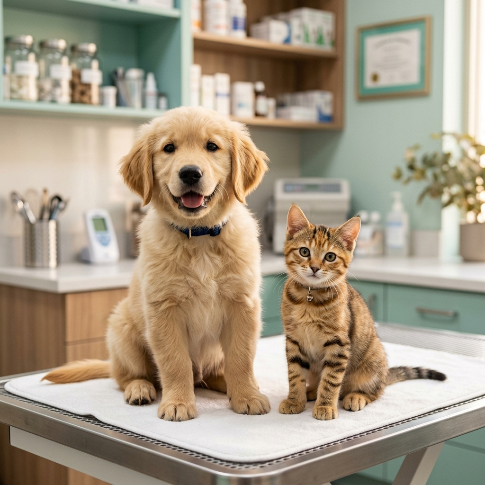

# 🐾 PetVida — Landing Page Veterinaria


> Landing page moderna y profesional para clínica veterinaria, diseñada para capturar clientes y agendar citas por WhatsApp.

---

## 📸 Vista Previa



---

## ✨ Características

| Característica | Detalle |
|---|---|
| 🎨 **Diseño Premium** | Paleta teal/esmeralda con gradientes, glassmorphism y micro-animaciones |
| 📱 **100% Responsive** | Adaptado para móvil, tablet y desktop |
| 💬 **WhatsApp Directo** | Todos los botones conectan directo a WhatsApp Business |
| ⚡ **Rápido** | HTML/CSS/JS puro — sin frameworks, carga instantánea |
| 🔍 **SEO Optimizado** | Meta tags, estructura semántica y heading hierarchy |
| ♿ **Accesible** | Soporte para lectores de pantalla y `prefers-reduced-motion` |
| ✏️ **Fácil de editar** | Todo el contenido se cambia desde un solo objeto `CONFIG` en `script.js` |

---

## 🏗️ Secciones

1. **Header** — Barra de promo + navegación sticky con efecto blur
2. **Hero** — Título impactante + imagen + badges flotantes animados + indicadores de confianza
3. **Estadísticas** — Años de experiencia, mascotas atendidas, veterinarios, emergencias 24/7
4. **Servicios** — 6 cards: Consulta, Vacunación, Laboratorio, Cirugía, Estética, Odontología
5. **Nosotros** — Imagen + beneficios con checkmarks
6. **Proceso** — 3 pasos para agendar cita (WhatsApp → Agenda → Visita)
7. **Testimonios** — 3 reseñas de clientes reales
8. **CTA Principal** — Sección de conversión con gradiente y botones prominentes
9. **Contacto** — 4 cards con dirección, horarios, teléfono y email
10. **Footer** — Links, redes sociales y copyright

---

## 🚀 Instalación

No requiere instalación. Simplemente abre `index.html` en tu navegador.

```bash
# Clonar el repositorio
git clone https://github.com/carlos2024r3223rw/PetVIda-Lnading-page.git

# Abrir en el navegador
cd PetVIda-Lnading-page
start index.html
```

O usa **Live Server** en VS Code para desarrollo con recarga automática.

---

## ✏️ Personalización

Abre `script.js` y edita el objeto `CONFIG` al inicio del archivo:

```javascript
const CONFIG = {
  // Tu número de WhatsApp (código de país + número, sin + ni espacios)
  whatsappNumber: "50370000000",

  // Teléfono fijo de la clínica
  phoneNumber: "+50322000000",

  // Servicios (agrega, quita o modifica)
  services: [
    { icon: "🩺", name: "Consulta General", desc: "Descripción..." },
    // ...más servicios
  ],

  // Testimonios de clientes
  reviews: [
    { name: "María G.", pet: "🐕 Max", text: "Excelente atención...", stars: 5 },
    // ...más reseñas
  ],
};
```

> 💡 **Solo editas `script.js`** — no necesitas tocar HTML ni CSS.

---

## 🛠️ Tecnologías

- **HTML5** — Estructura semántica
- **CSS3** — Variables, Grid, Flexbox, animaciones, glassmorphism
- **JavaScript** — Vanilla ES6+ (sin dependencias)
- **Google Fonts** — Playfair Display + Inter

---

## 📂 Estructura del Proyecto

```
PetVida-Landing-page/
├── index.html        # Estructura principal
├── style.css         # Estilos y diseño
├── script.js         # Lógica + contenido editable (CONFIG)
├── hero.png          # Imagen hero
├── services.png      # Imagen sección nosotros
└── README.md         # Este archivo
```

---

## 📄 Licencia

Este proyecto es de uso libre. Siéntete libre de usarlo, modificarlo y adaptarlo para tu clínica veterinaria.

---

<p align="center">
  Hecho con ❤️ y 🐾 para las mascotas
</p>
